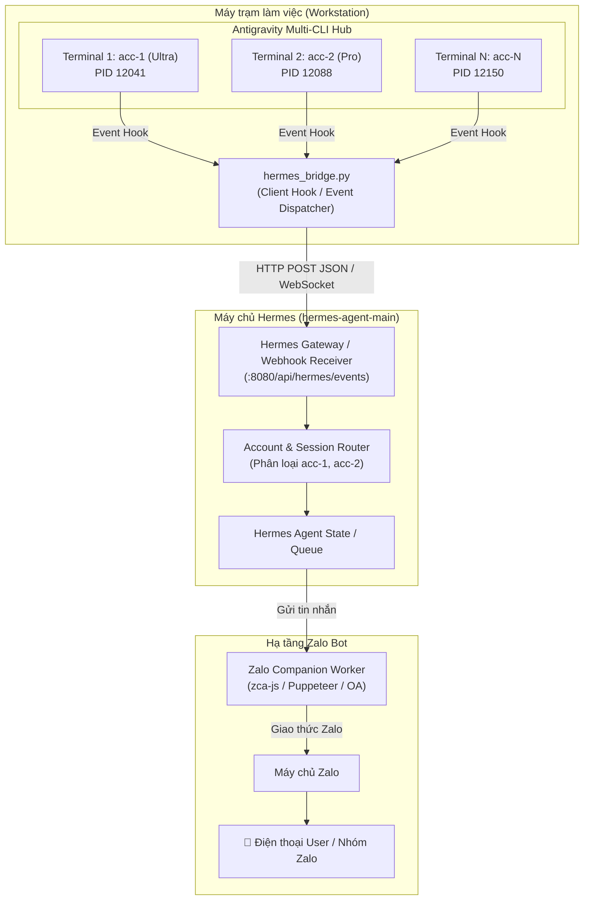

# ĐẶC TẢ KIẾN TRÚC KẾT NỐI: ANTIGRAVITY MULTI-CLI ➔ HERMES ➔ ZALO BOT

> **Tài liệu hướng dẫn kỹ thuật dành cho lập trình viên để triển khai tiếp trên máy chủ Hermes & Zalo.**  
> Dự án nguồn: `antigravity-multi-cli`  
> Phiên bản tài liệu: 1.0 (2026-10-30)

---

## 1. TỔNG QUAN KIẾN TRÚC HỆ THỐNG

Mục tiêu: Khi người dùng mở nhiều Terminal, mỗi Terminal chạy một tài khoản Google / Antigravity CLI riêng biệt (`acc-1`, `acc-2`, `pro-01`, `ultra-1`), mọi hoạt động (khởi động, lệnh tạo ảnh, thời gian render, lỗi quota 429, thoát terminal) đều được tự động nhận diện và gửi thông báo theo thời gian thực về **Zalo Bot**.



---

## 2. CƠ CHẾ NHẬN DIỆN TỪNG TERMINAL & TÀI KHOẢN

Để Hermes và Zalo phân biệt chính xác Terminal nào đang làm gì (kể cả khi chạy 10 Terminal song song), mỗi payload gửi đi từ [`hermes_bridge.py`](file:///Users/trieuhoang/Documents/Projects/antigravity-multi-cli/hermes_bridge.py) luôn mang bộ **Định danh 4 chiều (4-Dimension Identity)**:

1. **`account_id`**: Mã định danh tài khoản cục bộ (`acc-1`, `pro-01`, `ultra-vip`).
2. **`email`**: Địa chỉ Gmail Google thật tương ứng với tài khoản đó (trích xuất từ `id_token`).
3. **`pid`**: Process ID của tiến trình con trong hệ điều hành (để phân biệt nếu 1 account được mở trên 2 terminal khác nhau).
4. **`hostname`**: Tên máy trạm phát sinh lệnh (ví dụ: `MacBook-Pro-Cua-Trieu`).

---

## 3. ĐẶC TẢ GIAO THỨC DỮ LIỆU (JSON EVENT SPECIFICATION)

### 3.1. Cấu trúc Payload chuẩn (Base Envelope)

Mọi sự kiện gửi từ Terminal tới Hermes đều tuân thủ cấu trúc:

```json
{
  "source": "antigravity-multi-cli",
  "event_type": "EVENT_NAME",
  "account_id": "acc-1",
  "timestamp": "2026-10-30T04:45:00Z",
  "device": {
    "hostname": "Trieu-MacBook.local",
    "platform": "macOS-15.0-arm64",
    "python_version": "3.9.6"
  },
  "details": {
    /* Dữ liệu đặc thù của từng sự kiện */
  }
}
```

---

### 3.2. Danh sách các sự kiện cốt lõi

#### 1. Sự kiện `TERMINAL_STARTED` (Mở terminal)
Kích hoạt khi người dùng chạy `python3 run.py <acc_id>` hoặc bấm nút "Mở Terminal" trên Web UI.
```json
{
  "event_type": "TERMINAL_STARTED",
  "account_id": "acc-1",
  "details": {
    "email": "hoangtrieu.pro@gmail.com",
    "tier": "ultra",
    "pid": 48210
  }
}
```
*Tin nhắn Zalo tương ứng:*
> 🟢 **[Terminal Online]**  
> 👤 Tài khoản: **acc-1** (`hoangtrieu.pro@gmail.com`)  
> 🏷️ Hạng: ULTRA | PID: 48210  
> 💻 Máy trạm: Trieu-MacBook  
> ⏰ Đã kích hoạt phiên làm việc!

---

#### 2. Sự kiện `COMMAND_STARTING` (Bắt đầu chạy câu lệnh)
Kích hoạt khi gõ lệnh `agy -p ...` để tạo ảnh hoặc viết kịch bản.
```json
{
  "event_type": "COMMAND_STARTING",
  "account_id": "acc-1",
  "details": {
    "command": "agy -p 'Vẽ bìa sách chú rồng nhỏ' --output-format json",
    "pid": 48210
  }
}
```

---

#### 3. Sự kiện `COMMAND_FINISHED` (Câu lệnh hoàn tất)
```json
{
  "event_type": "COMMAND_FINISHED",
  "account_id": "acc-1",
  "details": {
    "command": "agy -p 'Vẽ bìa sách chú rồng nhỏ'...",
    "returncode": 0,
    "elapsed_s": 14.85
  }
}
```
*Tin nhắn Zalo tương ứng:*
> ✅ **[Lệnh Hoàn Thành]**  
> 👤 Tài khoản: **acc-1**  
> ⏱️ Thời gian: 14.85s  
> 📊 Trạng thái: Thành công (Code 0)

---

#### 4. Sự kiện `ERROR_429_QUOTA` (Chạm hạn ngạch Google)
Nếu câu lệnh trả về lỗi `RESOURCE_EXHAUSTED` hoặc `429`:
```json
{
  "event_type": "ERROR_429_QUOTA",
  "account_id": "acc-1",
  "details": {
    "error_snippet": "Google API 429: Quota exceeded for model Gemini 3.8",
    "suggested_action": "Chuyển sang tài khoản acc-2"
  }
}
```
*Tin nhắn Zalo tương ứng (Cảnh báo đỏ):*
> ⚠️ **[CẢNH BÁO QUOTA 429]**  
> 👤 Tài khoản: **acc-1** đã hết hạn ngạch Gemini!  
> 🔄 Vui lòng chuyển sang terminal **acc-2** để tiếp tục.

---

#### 5. Sự kiện `TERMINAL_EXITED` (Đóng Terminal)
```json
{
  "event_type": "TERMINAL_EXITED",
  "account_id": "acc-1",
  "details": {
    "pid": 48210
  }
}
```

---

## 4. HƯỚNG DẪN CODE TRÊN MÁY CHỦ HERMES (`hermes-agent-main`)

Trên máy chủ chạy Hermes, bạn cần tạo một Webhook Endpoint tiếp nhận các event từ `hermes_bridge.py`.

### 4.1. Mã nguồn Python (FastAPI Endpoint trong Hermes)

Lưu file này vào thư mục của Hermes, ví dụ `apps/zalo_bridge/listener.py`:

```python
from fastapi import FastAPI, Header, HTTPException, Request
import httpx
import json

app = FastAPI(title="Hermes Antigravity Terminal Listener")

HERMES_SECRET = "hermes-secret-key"  # Khớp với hermes_config.json

# Cấu hình địa chỉ Zalo Worker (Dựa theo ZALO_COMPANION_BOT_SPEC.md)
ZALO_WORKER_URL = "http://127.0.0.1:5005/api/zalo/send-message"
DEFAULT_ZALO_RECEIVER_ID = "g_123456789"  # ID Người nhận hoặc ID Nhóm Zalo

def format_zalo_message(data: dict) -> str:
    evt = data.get("event_type", "UNKNOWN")
    acc = data.get("account_id", "Unknown")
    details = data.get("details", {})
    ts = data.get("timestamp", "")

    if evt == "TERMINAL_STARTED":
        return f"🟢 [TERMINAL SẴN SÀNG]\n👤 Acc: {acc} ({details.get('email')})\n🏷️ Tier: {details.get('tier', '').upper()}\n⏰ {ts}"
    elif evt == "COMMAND_FINISHED":
        return f"✅ [TẠO ẢNH XONG]\n👤 Acc: {acc}\n⏱️ Xử lý: {details.get('elapsed_s')}s"
    elif evt == "ERROR_429_QUOTA":
        return f"🚨 [CHẠM LIMIT 429]\n👤 Acc: {acc} vừa bị giới hạn Quota!\n👉 Đổi sang Terminal khác ngay."
    elif evt == "TERMINAL_EXITED":
        return f"⚪ [TERMINAL ĐÓNG]\n👤 Acc: {acc} đã thoát."
    return f"ℹ️ [{evt}] Acc: {acc}\n{json.dumps(details, ensure_ascii=False)}"

@app.post("/api/hermes/events")
async def receive_terminal_event(request: Request, x_hermes_token: str = Header(None)):
    if x_hermes_token != HERMES_SECRET:
        raise HTTPException(status_code=401, detail="Invalid Hermes Token")

    data = await request.json()
    print(f"📥 [Hermes] Nhận sự kiện từ Terminal: {data.get('event_type')} ({data.get('account_id')})")

    # Format nội dung gửi sang Zalo
    zalo_text = format_zalo_message(data)

    # Chuyển tiếp tới dịch vụ Zalo Bot Worker
    try:
        async with httpx.AsyncClient(timeout=5.0) as client:
            await client.post(
                ZALO_WORKER_URL,
                json={
                    "recipient_id": DEFAULT_ZALO_RECEIVER_ID,
                    "message": zalo_text,
                    "metadata": data
                }
            )
    except Exception as e:
        print(f"⚠️ Chưa gửi được sang Zalo: {e}")

    return {"ok": True, "received": data.get("event_type")}
```

---

### 4.2. Cấu hình bên máy chạy Terminal (`antigravity-multi-cli`)

Chỉ cần sửa file [`hermes_config.json`](file:///Users/trieuhoang/Documents/Projects/antigravity-multi-cli/hermes_config.json) trong thư mục `antigravity-multi-cli`:

```json
{
  "hermes_enabled": true,
  "hermes_endpoint": "http://<IP_HOẶC_DOMAIN_MÁY_HERMES>:8080/api/hermes/events",
  "hermes_auth_token": "hermes-secret-key",
  "zalo_direct_webhook": "",
  "log_events": true
}
```

---

## 5. HƯỚNG DẪN KẾT NỐI VỚI ZALO BOT

Tuỳ thuộc vào loại bot Zalo mà hệ thống máy kia đang vận hành:

### Lựa chọn A: Zalo Cá Nhân qua `zca-js` / Puppeteer (Khuyên dùng nội bộ)
*Tham chiếu: `hermes-agent-main/ZALO_COMPANION_BOT_SPEC.md`*
- Zalo Bot Worker chạy đăng nhập tài khoản Zalo cá nhân (bằng cookie / QR code).
- Cung cấp API nội bộ `POST /api/zalo/send-message`.
- Nhận diện tin nhắn gửi theo ID nhóm chat (`group_id`) hoặc ID người chat (`user_id`).
- **Ưu điểm:** Miễn phí 100%, không cần đăng ký Doanh nghiệp, nhận thông báo vào nhóm Zalo riêng của team làm sách / AI Studio ngay lập tức.

### Lựa chọn B: Zalo Official Account (OA) qua ZNS / Webhook
- Dành cho doanh nghiệp đã đăng ký tích vàng.
- Gọi REST API chính thức của Zalo: `https://openapi.zalo.me/v3.0/oa/message/cs`.
- Cần truyền `access_token` của OA trong Header `access_token: <token>`.

---

## 6. CHECKLIST KIỂM THỬ KHI MANG SANG MÁY KIA

1. [ ] **Khởi động Hermes Listener:** Đảm bảo cổng `8080` (hoặc cổng cấu hình) mở và nhận được HTTP POST.
2. [ ] **Test Ping mẫu:** Trên máy trạm gõ:
   ```bash
   python3 hermes_bridge.py
   ```
   Xem log máy Hermes có in ra `📥 [Hermes] Nhận sự kiện: TEST_PING` hay không.
3. [ ] **Test Zalo Dispatch:** Kiểm tra tin nhắn Zalo có báo chuông trên điện thoại không.
4. [ ] **Test đa Terminal đồng thời:**
   - Terminal 1: `python3 run.py acc-1` ➔ Zalo báo `acc-1 online`.
   - Terminal 2: `python3 run.py acc-2` ➔ Zalo báo `acc-2 online`.
   - Terminal 1 chạy `agy` ➔ Zalo báo `acc-1 lệnh hoàn thành`.
   - Cả hai hoạt động song song không hề bị đè tin nhắn của nhau.
